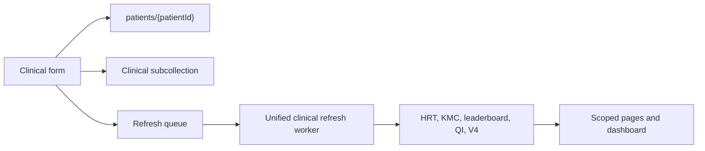

# MNCH Clinical Workflow Low-Level Design

**Audience:** Developers, technical reviewers, clinical product owners  
**Classification:** Restricted technical working document  
**Branch context:** `version-2-upgrade` testing branch  
**Status:** Current-state workflow map  
**Last reviewed:** 2026-11-03

This document describes the current source-of-truth records, client writes,
server refreshes, and derived products. Field names include canonical and
legacy aliases because the pilot database contains both.

## 1. Common workflow contract

### Write rules

- The authenticated field user writes clinical data through the client
  workflow, subject to Firestore rules and edit-window/supervisor rules where
  applicable.
- Server Functions write derived projections, contribution documents, caches,
  job state, and SMS audit records.
- A patient clinical write should enqueue one patient ID, not one job per
  downstream product.
- Refresh work must be idempotent. Replaying a patient ID should converge on
  the same derived state.

### Offline behavior

Registration and selected point-of-care forms can queue writes locally.
Dashboard, HRT, and KMC list pages use server projections and require a
connection. A reconnect should drain pending writes and request a patient
refresh; it should not trigger a national patient scan.

## 2. Registration and identity

### Source records

- `patients/{patientId}`: mother or baby profile, scope, status, links, and
  selected embedded summaries.
- `patient_counters`: ID-generation counters.
- `newborn_identity_keys`: idempotency keys linking a Delivery Note birth to a
  baby patient.

### Flow

1. User selects mother or baby registration.
2. Client validates required identity fields and patient type.
3. Client creates or updates the patient document.
4. Baby identity linking prevents duplicate baby creation for the same mother
   and birth order.
5. The clinical refresh queue receives the patient ID when derived products are
   affected.

### Invariants

- Patient IDs are stable after creation.
- Mother/baby relationships are explicit and deterministic.
- A baby record must not be silently counted as a second mother.
- Deletion/archive status must be respected by all projections and lists.

## 3. ANC and laboratory care

### Source records

- `patients/{patientId}/antenatal_visits/{visitId}`
- `patients/{patientId}/testRecords/{testId}` and legacy lab subcollections
- Embedded `antenatalVisits` and `testRecords` fields retained for legacy
  records and normalized by the server repository.

### Flow

1. Client loads one patient and bounded relevant visit history.
2. Midwife enters ANC date, visit number, clinical measures, risk flag,
   risk factors, TD, PMTCT/HIV, medicines, and follow-up information.
3. Validation prevents invalid dates and incomplete required clinical choices.
4. Client writes the visit/test and audit information.
5. The patient ID is queued for unified refresh.
6. Server normalization loads the patient’s relevant subcollections and
   constructs one deterministic clinical-facts object.
7. HRT, leaderboard, QI, and V4 contributions are recalculated idempotently.

### Important definitions

- ANC headcount is a unique mother with qualifying ANC activity in the
  selected period.
- External-facility ANC visits are normalized into the ANC visit history for
  milestone calculations.
- High-risk eligibility is based on accepted affirmative values for the ANC
  high-risk field and is shared with the HRT projection.
- PMTCT breakdowns distinguish ANC mothers with HIV testing, reactive cases,
  and their denominators.

### Read/write efficiency

The form may read one patient and bounded history. It must not query all
patients to calculate the next visit number or dashboard indicators. Server
analytics should consume normalized facts and contribution documents.

## 4. LCG, labour, and delivery notes

LCG means labour-care and labour/delivery documentation in the current app.

### Source records

- `patients/{patientId}/records/deliveryNotes`
- `patients/{patientId}/records/summary`
- `patients/{patientId}/records/startingTime`
- `patients/{patientId}/records/secondStage`
- labour-care records and legacy third-stage records where present
- Delivery Note baby arrays and birth anchors

### Flow

1. Client loads the selected mother and bounded labour/delivery records.
2. Provider records labour observations and Delivery Note details.
3. Delivery Note data becomes authoritative for delivery place, birth date,
   provider, babies, birth weights, gestational age, and newborn links.
4. The write creates or reconciles linked baby identity keys.
5. The patient ID is queued for all affected derived products.
6. Server projections use Delivery Notes before legacy delivery evidence.

### Invariants

- A locked/saved Delivery Note is not casually overwritten.
- Twin identity is preserved by baby index and canonical linked IDs.
- Delivery place and birth provider are separate clinical concepts.
- Home SBA and institutional delivery indicators use the approved definitions,
  not a guessed provider/place combination.

## 5. PNC and service closure

### Source records

- `patients/{patientId}/postpartum_visits/{visitId}`
- `patients/{patientId}/serviceClosure`
- maternal outcome and newborn outcome fields when applicable
- Delivery Note birth anchor and linked mother/baby data

### Flow

1. Client loads one mother or baby and bounded PNC history.
2. PNC form validates canonical mother/baby identity and Delivery Note
   requirements.
3. Provider records PNC visits, medicines, counselling, and outcomes.
4. Final service closure is a separate patient-level status and outcome
   operation.
5. For high-risk mothers, Select Patient must verify explicit HRT completion
   before allowing final service closure.
6. Patient refresh is queued after PNC or closure writes.

### Invariants

- Service closure does not silently change HRT, KMC, or PNC clinical outcomes.
- A high-risk mother cannot be closed from Select Patient while HRT remains
  incomplete.
- Reopening a service closure requires an explicit authorized action.

## 6. Newborn and immediate newborn care

### Source records

- `patients/{babyPatientId}/immediate_newborn_care/{visitId}`
- `patients/{babyPatientId}/newborn_care/{visitId}`
- Delivery Note baby arrays and mother/baby links
- newborn outcome and death details

### Flow

1. Client resolves the canonical baby patient and mother identity.
2. Immediate newborn care validates required breathing status and clinical
   fields.
3. Newborn follow-up records weight, feeding, danger signs, and care measures.
4. Baby-specific writes queue the canonical patient/mother family for refresh.
5. KMC projections are generated per baby, never collapsed across twins.
6. Delivery Note birth data remains authoritative for birth-time identity and
   birth measures.

### Invariants

- Each twin has independent newborn and KMC measures.
- Baby indicators count registered baby clients according to the V4 contract.
- Newborn death details are required only when a death outcome is selected.
- A missing baby link must result in a clear repair state, not a fabricated ID.

## 7. HRT and KMC projections

### HRT

`tracking_v2_hrt/{patientId}` is a server projection. It contains the
role-scoping fields, risk factors, ANC count, due date, status, explicit
completion state, and postpartum reminder information.

HRT status is current and mutually exclusive: on track, overdue, defaulted, or
complete. Completion is an explicit action and can currently be reversed. The
HRT page uses paginated callable results and retains SMS controls for midwives.

### KMC

`tracking_v2_kmc/{patientId}_{babyIndex}` is a server projection. It is
calculated independently per baby and exposes role-scoped paginated tracking
rows.

### Refresh

Clinical writes enqueue `tracking_v2_refresh_queue/{patientId}`. The unified
worker refreshes projections. A repair worker exists for deliberate
checkpointed rebuilds; it is not a normal page-load path.

## 8. Dashboard V4

### Source and flow

1. Clinical facts produce additive patient contributions in
   `analytics_v4_contributions`.
2. `queryDashboardV4` validates date range, role scope, and filters.
3. The server aggregates contributions and may use
   `analytics_v4_range_cache`.
4. The client receives metrics and series by dimension; it never scans
   patients for dashboard calculations.
5. Current HRT status cards use a separate role-scoped tracking summary because
   current statuses must not be summed from monthly contributions.

### Dashboard contract

- Filter values can narrow only the authenticated role scope.
- Dates are inclusive and interpreted using the application reporting
  timezone.
- Missing summaries show a bounded loading/error state, not a blank page.
- Cached results are displayed only with clear freshness state.
- Exports use the same server authorization and aggregation contract.

## 9. Leaderboard, transfers, and joint care

- Leaderboard contributions are refreshed from patient activity and rebuilt by
  bounded queue/reconciliation workers.
- Transfer requests preserve patient identity and require scope-aware actions.
- Joint-care links are indexed by patient and active linked providers so a
  midwife can see assigned patients without collection-wide client scans.
- The first Joint Care index build is a maintenance operation; later refreshes
  should use the updated-at cursor and queue.

## 10. Failure and retry behavior

- Queue entries are idempotent and safe to replay.
- Workers use checkpoints and leases to avoid concurrent broad rebuilds.
- A failed patient refresh is recorded and does not block unrelated patients.
- Client pages retain a stale-but-labelled view only when a validated cached
  result exists.
- A Function timeout must leave a resumable job state, not restart from the
  first patient.
