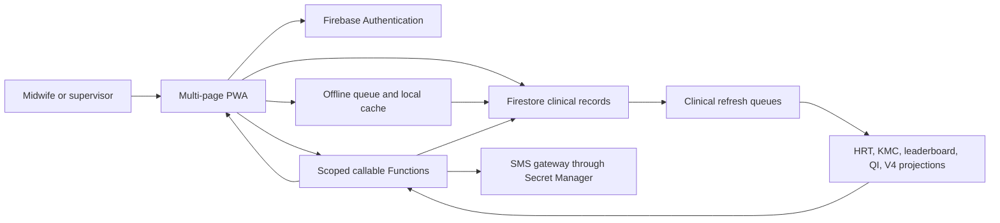

# MNCH National-Scale System Design

**Audience:** Technical leads, programme operations, release managers  
**Classification:** Restricted technical working document  
**Branch context:** `version-2-upgrade` testing branch  
**Status:** Current-state design and scale recommendations  
**Last reviewed:** 2026-11-03

## 1. Purpose and capacity target

The MNCH Care App supports maternal, newborn, and child-health workflows for
field midwives and supervisors. The immediate planning target is approximately
800 midwives, with national-scale growth in patients and clinical records.

The important capacity unit is not only the number of users. Firestore cost and
latency are driven by patient volume, clinical activity, concurrent sessions,
scheduled work, and whether a page reads raw patient records or a projection.

The current application can scale to this target without a React rewrite or a
database migration, provided broad page-load reads and repeated reconciliation
scans are controlled.

## 2. Current architecture

### Runtime components

- **Static client:** HTML, CSS, and JavaScript files hosted by Netlify or
  equivalent static hosting.
- **Authentication:** Firebase Authentication with a user profile in `users`.
- **Primary database:** Cloud Firestore. Mother and baby records live in
  `patients`; clinical records use patient subcollections and embedded fields.
- **Server API:** Firebase callable Functions and scheduled Gen 2 Functions.
- **Derived products:** HRT/KMC tracking projections, leaderboard summaries,
  quality summaries, and Dashboard V4 contribution/range summaries.
- **Offline support:** Browser cache, IndexedDB/offline queues, and bounded
  synchronization. Live tracking and national dashboard views require a
  connection to server projections.
- **External integration:** SMS is sent server-side; credentials must remain
  in Secret Manager.

The application deliberately remains a multi-page PWA. A React/Vite rewrite
could improve component reuse, but it would not by itself reduce Firestore
reads, scheduled scans, or write volume.

## 3. Environment and deployment boundaries

The same codebase supports environment-specific Firebase configuration. The
testing branch must keep service-worker registration disabled until an approved
production/midwife release.

Production changes must distinguish:

1. Static frontend deployment through Netlify.
2. Function deployment through Firebase.
3. Firestore rules/index deployment.
4. Derived-data rebuilds, which are separate operational actions.

A frontend deploy must not be assumed to rebuild analytics. A function deploy
must not be assumed to refresh old contribution documents.

## 4. Scope and authorization

The supported role hierarchy is:

- **Midwife:** owned and care-team patients; point-of-care entry and own
  operational views.
- **TMO:** township-scoped patients and supervisory workflows.
- **Regional Officer:** region-scoped patients and reporting.
- **Central, Super Admin, and admin:** national operations and administration.

Role checks exist in both callable Functions and Firestore rules. The client may
hide controls for usability, but it must never be the only authorization layer.

Callable tracking and dashboard APIs must derive the effective scope from the
authenticated `users/{uid}` profile. Client-provided filters may narrow scope,
but may not widen it.

## 5. Scale design principles

### Prefer event-driven refresh

Clinical writes enqueue a patient ID. The unified clinical refresh worker
rebuilds affected products for that patient. This is the preferred path for
normal operation.

### Keep lists server-projected

HRT and KMC pages use server projections with scoped pagination. They should not
scan all patients in the browser.

### Keep analytics aggregate-only

Dashboard V4 reads contribution documents and server-generated range caches
through a callable. It should not load patient records or calculate national
metrics in the browser.

### Bound every maintenance job

Repair and rebuild jobs need a checkpoint, batch limit, lease, retry policy,
maximum runtime, and visible progress. A lost checkpoint must not cause an
unattended full scan every few minutes.

### Treat cost as a product requirement

Every new feature should document its expected reads, writes, indexes, and
scheduled frequency. A page that reads 10,000 patient documents for a count is
not acceptable when a projection or count summary can answer the question.

## 6. Main risks at 800 midwives

1. Unbounded patient queries in older operational pages.
2. Daily full tracking reconciliation across every HRT/KMC row.
3. Duplicate derived-product refreshes for the same patient.
4. Large repair jobs competing with normal queue workers.
5. Missing or weak composite indexes causing retries and slow queries.
6. Patient documents acting as an unversioned schema with inconsistent legacy
   aliases.
7. Insufficient monitoring of Function duration, Firestore operations, and
   queue age.

The scan audit in
[`scale-read-write-scan-audit.md`](./scale-read-write-scan-audit.md)
prioritizes these risks without changing production behavior.

## 7. Recommended target state

The target state is still Firebase/Firestore with the existing PWA:

- one queue-driven clinical refresh worker
- patient-level HRT/KMC projections
- server-side paginated operational lists
- V4 aggregate contributions and range caches
- explicit scheduled reconciliation only where a time-dependent status truly
  requires it
- documented Firestore schema and role matrix
- load tests that measure reads, writes, latency, and queue recovery

A migration to Supabase should be considered only if there is a separate
requirement for relational analytics, SQL-heavy reporting, or a strategic
platform change. It is not required for 800 midwives.
