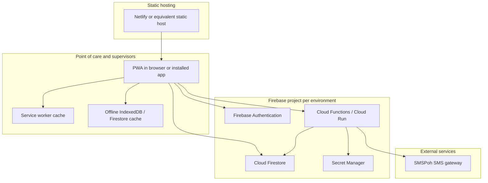
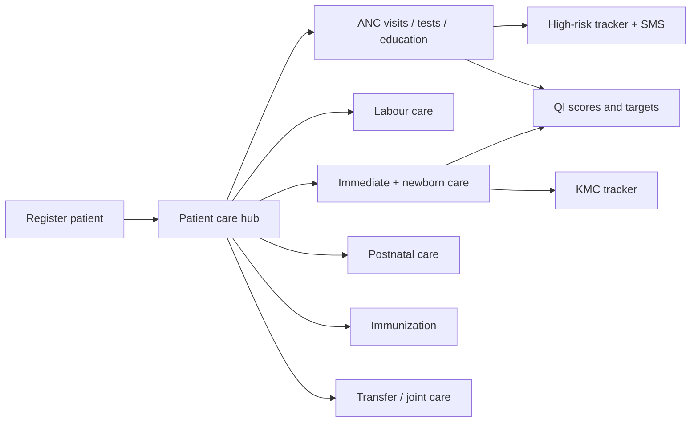

# System Design and Architecture

**Product:** Maternal, Newborn and Child Health (MNCH) Care App  
**Audience:** Programme and management stakeholders  
**As of:** September 2026

This document describes how the app is built, how data moves, and how it is intended to run at national scale. It is written from the current production design, not from a future roadmap.

---

## 1. What the system is

The MNCH app is a **progressive web application (PWA)** used by midwives and supervisors on phones, tablets, and desktops. It supports the continuum of maternal and newborn care:

- patient registration and identity
- antenatal care (ANC)
- labour and delivery
- immediate and follow-up newborn care, including Kangaroo Mother Care (KMC)
- postnatal care (PNC)
- immunization
- high-risk pregnancy follow-up
- transfers and joint care
- quality improvement / quality assurance (QI/QA)
- continuous medical education (CME)
- analytics, township reports, and a midwife scoreboard

The same codebase can run against **environment-specific Firebase projects** so a pilot database and a Ministry of Health (MOH) deployment stay separate.

| Environment | Purpose |
|---|---|
| Pilot Firebase project (`labourcare-2481a`) | Existing pilot data and operations |
| MOH / MNCH Firebase project (`mnch-1cbda`) | National MNCH deployment (for example `mnch-v2.netlify.app`) |

---

## 2. High-level architecture

**Design intent**

- Midwives work in the field, often on poor networks. The client is a PWA with a service worker, offline queues, and Firestore persistence where the browser allows it.
- Clinical records are written to **Cloud Firestore**. Security is enforced in **Firestore rules**, not only in the user interface.
- Heavy analytics (leaderboard, tracking lists, quality scores) are **recomputed on the server** and stored as projections. The home screen and tracking pages should not fan out into large live queries.
- Sensitive credentials (for example SMS API keys) stay in **Firebase Secret Manager**. They are never shipped in the PWA.

---

## 3. Client architecture

### 3.1 Application style

The front end is a multi-page PWA (HTML, CSS, and JavaScript), not a single-page React/Next app. Shared behaviour lives in `js/` modules:

- authentication and session (`auth-guard.js`, `session-manager.js`)
- role-based access (`rbac-manager.js`)
- offline store and sync (`offline-manager.js`, `offline-sync.js`, `sync-manager.js`)
- clinical helpers (high-risk, KMC, ANC follow-up status, birth anchors)
- analytics refresh queue (asks the backend to rebuild a patient’s summaries)
- tracking reader (calls server functions for HRT and KMC lists)

English and Myanmar are supported throughout the clinical workflow.

### 3.2 Device and PWA behaviour

The product is designed for **iPhone, iPad, Android, and desktop**, including installed PWA mode:

- viewport and safe-area insets for notched phones
- compact headers so clinical lists start high on the screen
- service worker cache versioning so installed apps pick up updates after deploy
- long-polling Firestore settings so networks that block WebSockets still work

### 3.3 Offline and sync

When a midwife is offline or on a weak link:

1. Care forms can be queued locally.
2. On reconnect, a sync manager writes pending records to Firestore.
3. The client then requests a **backend refresh** for that patient so HRT, KMC, leaderboard, and quality scores catch up.

Some screens (notably live tracking lists) require a connection because they read **server projections**, not a full local copy of the national register.

---

## 4. Data architecture

### 4.1 Primary store: Cloud Firestore

The main collections include:

| Area | Typical collections / documents |
|---|---|
| Identity | `users` |
| Clinical record | `patients/{id}` and care subcollections (`antenatal_visits`, `postpartum_visits`, `newborn_care`, `immediate_newborn_care`, lab/test records, labour records, consents) |
| Continuity | transfer requests, joint-care / care-team fields on the patient |
| Tracking projections | `tracking_v2_hrt`, `tracking_v2_kmc`, refresh queues |
| Analytics | dashboard and leaderboard contribution documents |
| Quality | quality score months, targets, action-plan reasons |
| SMS audit | `sms_sends` (server-written only) |

Mother and baby records both live in `patients`. Baby records are linked through mother/baby identifiers so joint care and KMC stay on one family record.

### 4.2 Why projections exist

National-scale lists (every high-risk pregnancy, every KMC baby) cannot be built by scanning all patients in the browser. After a visit is saved, the app enqueues `tracking_v2_refresh_queue/{patientId}`. A scheduled Cloud Function rebuilds that patient’s HRT/KMC row.

That is why a newly marked high-risk patient can take **a few minutes** to appear on the High Risk Tracker.

### 4.3 Security model

- Users sign in with Firebase Authentication.
- Role and scope (facility, township, region, care team) live on the user profile.
- Firestore rules gate reads and writes. UI hiding is convenience only.
- Some collections are **admin-SDK only** (for example SMS send logs). Clients cannot invent an SMS audit row.

---

## 5. Backend architecture (Cloud Functions)

Functions run in `us-central1` (Gen 2 / Cloud Run for newer callables). They do work the browser must not do:

| Capability | Role |
|---|---|
| `queryHrtTracking` / `queryKmcTracking` | Scoped, paginated tracking lists |
| `startTrackingProjectionRepair` + scheduled workers | Rebuild HRT/KMC projections in batches |
| `sendHrtSms` | Preview and send official high-risk SMS via SMSPoh |
| Leaderboard rebuild / nightly reconciliation | Midwife scoreboard |
| Dashboard V2 rebuild | Aggregated analytics |
| Quality month recompute | QI scores from clinical records |
| Admin account operations | Password reset, Super Admin email change |

Refresh workers are **scheduled** (for example every 5 minutes for tracking) because the chosen region cannot host some Firestore document triggers. Daily/weekly reconciliation jobs catch missed queue items.

---

## 6. Role and scope model

Access is geographic and operational, not “see every patient in the country” for every user.

| Role | Typical scope |
|---|---|
| Midwife | Own patients and care-team patients; point-of-care entry; own dashboard and QI plan |
| Township Medical Officer (TMO) | Township patients, township reports, visit-edit approvals |
| Regional Officer | Region patients and reports; can comment on QI plans |
| Super Admin / Central / Admin | National operations, user approval, system tools |

Supervisors see facility contact details on tracking lists. **Sending patient SMS is midwife-only** and is limited to patients in that midwife’s HRT scope.

---

## 7. Integration architecture

### 7.1 SMS (high-risk follow-up)

On the MOH project, a midwife can send official high-risk SMS from the HRT page.

- The PWA never holds SMSPoh keys.
- `sendHrtSms` loads the patient, chooses approved templates (or a midwife-written custom message), normalizes a Myanmar mobile number, and calls SMSPoh.
- Each send is logged in `sms_sends`.
- If the patient had no phone, the midwife can enter one and the function saves it on the patient record and the HRT projection.

The SMS button is **not shown on the pilot project**, so pilot midwives are not pointed at the MOH SMS account.

KMC, generic ANC, and PNC SMS templates exist in programme documents but are **not implemented in the app yet**.

### 7.2 Hosting and configuration

Static files are hosted independently of Firebase (commonly Netlify). A runtime file (`firebase.runtime-config.json`) can point the same PWA build at the MOH Firebase project without rebuilding every HTML file.

---

## 8. Clinical workflow architecture

A midwife registers or selects a patient, then works from the **care hub**. Each module writes structured clinical fields. Those fields feed:

- the patient’s longitudinal record and printable reports
- HRT / KMC follow-up lists
- dashboard coverage charts
- QI competency percentages
- the midwife scoreboard

---

## 9. Quality and performance principles baked into the design

These are product constraints, not optional polish:

- Treat every change as **production healthcare software** for national MNCH use.
- Prefer indexed queries and cached summaries over page-load fan-out.
- Keep one codebase; switch environment with configuration.
- Protect the pilot database when deploying MOH changes.
- Validate authorization in Firestore rules and Cloud Functions.
- Keep the UI professional, readable, and usable with 44px touch targets on phones.

---

## 10. Operational view for management

| Concern | How the system addresses it |
|---|---|
| Scale beyond a pilot | Server projections, pagination, scheduled rebuilds |
| Two deployments | One codebase, two Firebase projects |
| Field connectivity | PWA cache, offline queue, long polling |
| Data quality / late edits | 7-day self-edit window; older edits need TMO approval |
| Continuity across facilities | Transfers and joint care by patient ID |
| Accountability | Auth, roles, audit-oriented logs, SMS send log |
| Supervisor oversight | Township/region dashboards, QI review actions, visit approvals |

---

## 11. Related documents

- [All features](./features.md)
- [QI/QA feature summary](./qi-qa-features.md)
- [Point-of-care midwife quality features](./point-of-care-midwife-quality.md)
